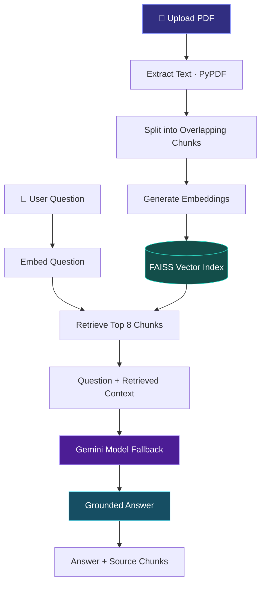

# ✦ DocuMind
### Your documents. Understood by AI.

<p align="center">
  <a href="https://documind-by-ayush.streamlit.app/">
    
  </a>
  <a href="https://github.com/Codeayu/DocuMind">
    
  </a>
</p>

<p align="center">
  
  
  
  
  
</p>

---

## 💡 What is DocuMind?

**DocuMind** is an AI-powered PDF assistant built with **Retrieval-Augmented Generation (RAG)**. It allows users to upload a PDF, ask questions in natural language, and receive answers grounded in the document's content.

Instead of relying exclusively on an AI model's general knowledge, DocuMind retrieves relevant passages from the uploaded document and provides them as context for answer generation.

> Upload a document. Ask a question. Get a contextual answer with source references.

<p align="center">
  <a href="https://documind-by-ayush.streamlit.app/"><strong>→ Explore the live application</strong></a>
</p>

---

## ✨ Features

| Feature | Description |
|---|---|
| 📄 **PDF Processing** | Extract text from uploaded, text-based PDFs. |
| 🧩 **Overlapping Chunking** | Divide document text into manageable chunks while preserving context across boundaries. |
| 🧠 **Semantic Embeddings** | Represent text using Sentence Transformers. |
| 🔎 **Vector Search** | Retrieve relevant passages using FAISS similarity search. |
| 🤖 **Context-Grounded Answers** | Generate answers using retrieved document context and Google Gemini. |
| 🔄 **Model Fallback** | Attempt alternative configured Gemini models when a model encounters eligible quota or service errors. |
| 📚 **Source Inspection** | View retrieved chunks and similarity scores alongside answers. |
| 💬 **Interactive Chat** | Ask follow-up questions about the uploaded PDF during the session. |
| 🎨 **Modern Interface** | Dark-themed Streamlit UI with an integrated developer page. |

---

## 🏗️ Architecture

DocuMind uses a retrieval-augmented generation pipeline to connect a user's question with relevant document content.



### ⚙️ How the pipeline works

1. **Extract:** PyPDF extracts selectable text from the uploaded document.
2. **Chunk:** Text is split into chunks of approximately **1,000 characters**, with **150 characters of overlap**.
3. **Embed:** Sentence Transformers converts chunks into vector embeddings.
4. **Index:** FAISS stores the vectors in an in-memory similarity-search index.
5. **Retrieve:** The application retrieves up to **8 relevant chunks** for a question.
6. **Generate:** The question and retrieved passages are sent to a configured Gemini model.
7. **Fallback:** If an eligible API error occurs, the generator attempts another configured model.
8. **Inspect:** The application displays the answer and retrieved source chunks.

---

## 🧰 Tech Stack

<table>
  <tr>
    <td width="180"><strong>Language</strong></td>
    <td>Python</td>
  </tr>
  <tr>
    <td><strong>UI</strong></td>
    <td>Streamlit</td>
  </tr>
  <tr>
    <td><strong>PDF Extraction</strong></td>
    <td>PyPDF</td>
  </tr>
  <tr>
    <td><strong>Embeddings</strong></td>
    <td>Sentence Transformers · <code>all-MiniLM-L6-v2</code></td>
  </tr>
  <tr>
    <td><strong>Vector Search</strong></td>
    <td>FAISS · Inner-product similarity search</td>
  </tr>
  <tr>
    <td><strong>LLM</strong></td>
    <td>Google Gemini API</td>
  </tr>
  <tr>
    <td><strong>Configuration</strong></td>
    <td>python-dotenv · Streamlit Secrets</td>
  </tr>
  <tr>
    <td><strong>Deployment</strong></td>
    <td>Streamlit Community Cloud</td>
  </tr>
</table>

---

## 📂 Project Structure

```text
DocuMind/
├── .streamlit/
│   └── config.toml
├── app.py                 # Streamlit application
├── main.py                # PDF text extraction utilities
├── chunker.py             # Text chunking
├── retriever.py           # Embeddings and FAISS retrieval
├── generator.py            # Gemini generation and model fallback
├── requirements.txt       # Python dependencies
├── .gitignore             # Excluded files and secrets
└── README.md              # Project documentation
```

---

## 🚀 Run Locally

### Prerequisites

- Python 3.10+ (use a version supported by your installed dependencies)
- A Google Gemini API key
- Git

### 1. Clone the repository

```bash
git clone https://github.com/Codeayu/DocuMind.git
cd DocuMind
```

### 2. Create a virtual environment

**Windows**

```powershell
python -m venv .venv
.venv\Scripts\activate
```

**macOS / Linux**

```bash
python -m venv .venv
source .venv/bin/activate
```

### 3. Install dependencies

```bash
pip install -r requirements.txt
```

### 4. Configure environment variables

Create a `.env` file in the project root:

```env
GEMINI_API_KEY=your_gemini_api_key
```

Get an API key through [Google AI Studio](https://aistudio.google.com/).

**🔐 Security:** Never commit `.env`, API keys, or secret configuration files to GitHub.

### 5. Start DocuMind

```bash
streamlit run app.py
```

Open the local URL displayed in your terminal, usually `http://localhost:8501`.

---

## ☁️ Live Deployment

**Try DocuMind:** [documind-by-ayush.streamlit.app](https://documind-by-ayush.streamlit.app/)

The application is hosted on Streamlit Community Cloud.

To deploy your own instance:

1. Fork this repository.
2. Connect your GitHub account to [Streamlit Community Cloud](https://share.streamlit.io/).
3. Create an app using `app.py` as the main file.
4. Add the following secret under the app's **Settings → Secrets**:

```toml
GEMINI_API_KEY = "your_gemini_api_key"
```

5. Deploy the application.

---

## 🔄 Model Fallback & Reliability

The generator supports a configurable sequence of Gemini models.

When a model encounters an eligible error, such as quota exhaustion or a temporary service failure, DocuMind can attempt another configured model.

Fallback is best-effort: the alternative model must be available to the API project and have remaining quota. If all configured models fail, the application returns a user-friendly error message.

---

## ⚠️ Limitations

- Currently designed for **one text-based PDF per active session**.
- Scanned PDFs may require OCR before their text can be extracted.
- Retrieval quality depends on text extraction, chunk boundaries, and the relevance of retrieved passages.
- Generated answers may contain errors; verify important details against the original document.
- Gemini quotas, model availability, and response times may affect answer generation.
- The current FAISS index is held in memory rather than persisted as a permanent vector database.

---

## 🛣️ Future Improvements

- [ ] OCR for scanned documents
- [ ] Multiple-document knowledge bases
- [ ] Persistent vector storage
- [ ] Hybrid keyword and semantic retrieval
- [ ] Reranking for improved retrieval relevance
- [ ] Retrieval evaluation and automated tests
- [ ] Streaming responses
- [ ] Improved model availability and fallback monitoring

---

## 👨‍💻 About the Developer

**Ayush Chainani**  
*AI & Data Science Engineer · Python Developer*

I enjoy building practical applications that combine backend engineering, data, and AI. DocuMind is a hands-on project exploring how document processing, vector search, retrieval, and large language models work together in a real application.

<p align="left">
  <a href="https://ayushchainani.dev">
    
  </a>
  <a href="https://github.com/Codeayu">
    
  </a>
  <a href="https://documind-by-ayush.streamlit.app/">
    
  </a>
</p>

---

## 🤝 Feedback & Contributions

Suggestions, bug reports, and contributions are welcome.

- Open an issue to report a bug or propose an improvement.
- Submit a pull request with your proposed changes.
- Share feedback about retrieval quality and answer grounding.

## 📄 License

No license is currently specified. Until a license is added, reuse and redistribution permissions are not explicitly granted.

---

<p align="center">
  <strong>Built with curiosity. Powered by retrieval. Designed for useful answers.</strong>
  <br><br>
  <a href="https://documind-by-ayush.streamlit.app/">🚀 Try DocuMind</a>
  &nbsp; · &nbsp;
  <a href="https://github.com/Codeayu/DocuMind">⭐ Explore the Repository</a>
</p>
